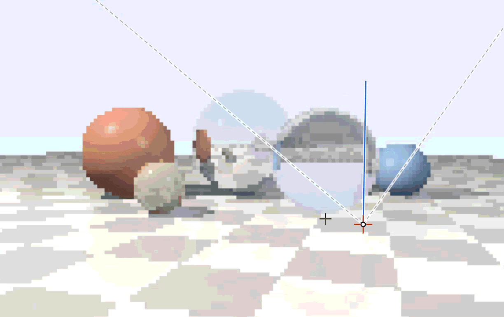

# raytrace
Interactive CPU ray tracer in the browser. 

Click a pixel to trace it. You'll see the ray tree drawn over the image and in a 2D schematic, along with each number used along the way: the intersection maths for every object, the surface normal, the shadow rays, the Phong lighting terms, Snell refraction, Fresnel weights and how the final color is blended. There's no WebGL and no 3D library. The renderer is about 400 lines of plain TypeScript running on the CPU.

### Clone, then run it with: 

```sh
npm install
npm run dev
```

## layout

```
src/
  rt/
    vec.ts         vector math
    scene.ts       scene types, defaults, camera basis, projection
    tracer.ts      intersection, shading, recursion, step recording
    renderer.ts    progressive canvas renderer and stats
  components/
    Viewport.tsx   canvas, ray overlay, orbit/pan/zoom/pick
    Schematic.tsx  top/front 2D view with draggable objects
    Inspector.tsx  ray tree and per-step calculations
    Sidebar.tsx    render, camera, scene and material controls
    ui.tsx         small UI primitives
```

## stack

TS · React · Vite · Tailwind. 
